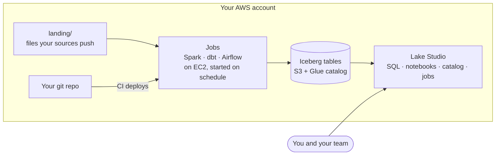

  <picture>
    <source media="(prefers-color-scheme: dark)" srcset=".github/assets/datahighland-lockup-dark.svg">
    
  </picture>

<strong>Own your data lake.</strong> 
Your own data lakehouse, in your own AWS account, at AWS prices.

  <a href="https://datahighland.dev">Website</a> ·
  <a href="#status">Status</a> ·
  <a href="#roadmap">Roadmap</a> ·
  <a href="LICENSE">Apache 2.0</a>

---

## Why

Managed lakehouse platforms are great, and they charge a premium on top of the cloud. If your product runs on a lot of
data and every dollar counts, that premium is the problem.

DataHighland gives you the same way of working (notebooks, a SQL editor, a catalog of your tables, scheduled jobs with
run history) built from plain AWS services in **your own account**. You pay AWS directly, and nothing on top. When nobody
is working, nothing is running.

It started as the lakehouse its creator built for his own products, because he couldn't justify a premium platform for
them either.

## What you get

| | |
|---|---|
| **Lake Studio** | A browser workspace: SQL editor with a results grid, catalog browser (databases, tables, columns, sample rows, Iceberg history), jobs with run history, graphs and logs, and VS Code or JupyterLab on your projects |
| **Notebooks with Spark ready** | Python, PySpark and `%%sql` cells; `spark` is there when the notebook opens |
| **Pipelines as code** | Python and PySpark jobs, dbt models and an Airflow DAG per project, in git. Schedules live in the code; CI deploys them |
| **Open tables** | Apache Iceberg on S3 with the AWS Glue catalog. Any engine that reads Iceberg can read your data; nothing is locked in |
| **Near-zero idle cost** | No always-on cluster and no NAT gateway. Machines start for work and stop by themselves |
| **Private by default** | Production data readable only inside your network, by known roles. Only CI deploys to production, only jobs write production data, and ingested data is signed so tampering shows |
| **Your laptop or the browser** | Develop locally in VS Code, or in Lake Studio from anywhere |

## What it costs

There is no DataHighland fee. You pay AWS for what you use: EC2 while machines run, S3 for storage, and a few cents for
the Glue catalog. How often your jobs run decides most of the bill, and that choice is yours.

We'll publish measured monthly costs (a mostly idle setup and a busy one) with the first release.

## How it works

Each data project is its own git repository: jobs, dbt models and a DAG. Push to `main`, and CI publishes it and sets
its schedules. At the scheduled time a small machine starts, runs what's due, records the run and stops.

## Who it's for

- Builders and small teams whose product depends on their own data, and who watch costs closely.
- Data engineers who like the managed-platform way of working, and want to own and understand every piece.

Not for you if a managed platform's price is no problem and you'd rather not run anything yourself.

## Status

**Early, and being built in public.** Everything in "What you get" works today, in one AWS account that was set up by
hand. It is not yet installable into your account with one command; that is the first milestone.

Watch or star this repository to follow along.

## Roadmap

- [ ] One-command install into your own AWS account
- [ ] Getting-started guide and a sample project
- [ ] Measured monthly costs, idle and busy
- [ ] Bigger machines on demand for heavy jobs
- [ ] Failure alerts by email

## Who's behind it

Created by [Fahad](https://github.com/fahad-m-nasim), a data engineer in Sydney, and maintained by
**Greenvale IT Solutions Pty Ltd**. Want DataHighland set up or run for you? Get in touch through
[datahighland.dev](https://datahighland.dev).

## License

[Apache 2.0](LICENSE). Copyright 2026 Greenvale IT Solutions Pty Ltd.

AWS and the other product names here are trademarks of their owners. DataHighland is built on AWS and is not
affiliated with or endorsed by Amazon Web Services.
